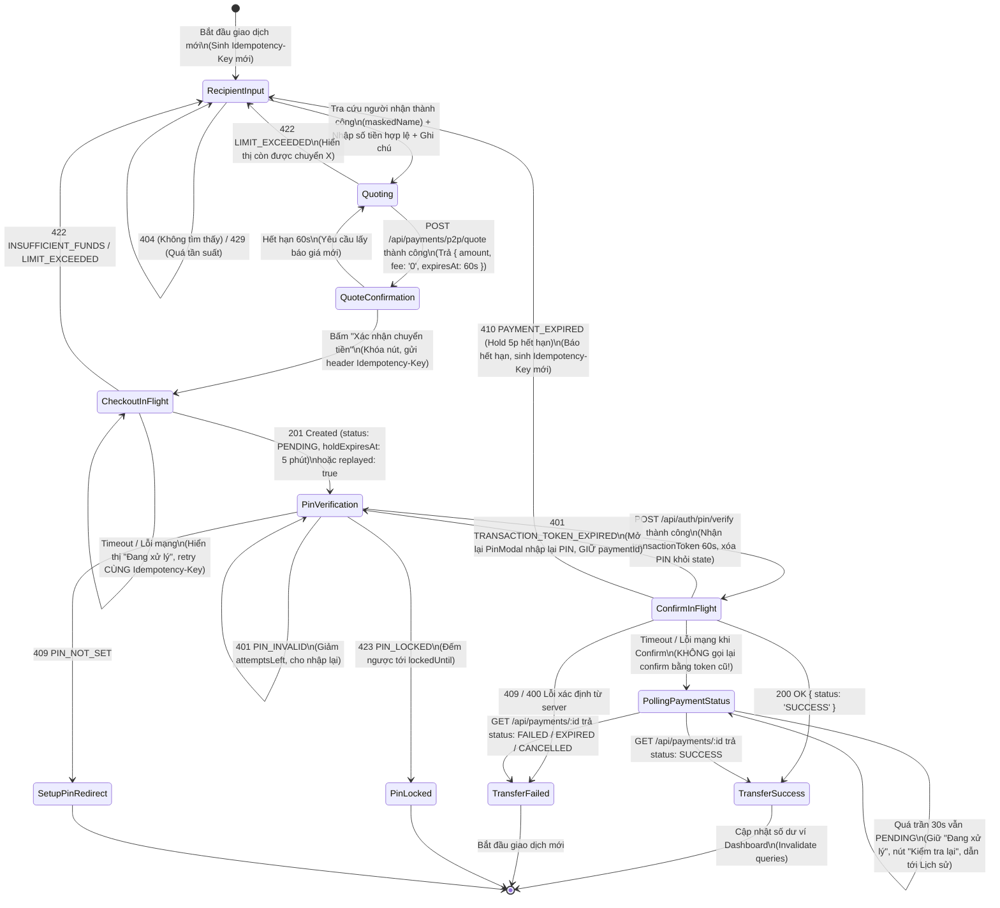

# TÀI LIỆU THIẾT KẾ KIẾN TRÚC K18: VÍ, CHUYỂN TIỀN P2P & LỊCH SỬ SỔ CÁI

> **Mã nhiệm vụ:** K18 (Frontend Web)  
> **Dự án:** Ví điện tử FinVault  
> **Nguồn sự thật:** OpenAPI spec (`packages/api-contract/openapi.yaml`) & Backend Gateway endpoints (`/api`)

---

## 1. SƠ ĐỒ TRẠNG THÁI MÀN HÌNH CHUYỂN TIỀN P2P (TRANSFER STATE MACHINE)

---

## 2. QUY TẮC VÒNG ĐỜI IDEMPOTENCY-KEY & TRANSACTION-TOKEN

### 2.1. Idempotency-Key
- **Khởi tạo:** Sinh bằng chuẩn UUID v4 (`crypto.randomUUID()`) ngay khi người dùng mở màn hình chuyển tiền hoặc bắt đầu một ý định chuyển tiền mới.
- **Duy trì (Strict Retention):** Giữ nguyên key khi:
  - Bấm nút xác nhận thanh toán nhiều lần liên tiếp (chống double click / duplicate request).
  - Yêu cầu gặp lỗi timeout mạng hoặc mất kết nối: Hệ thống tự động/cho phép người dùng thử lại với **CÙNG Idempotency-Key**.
  - Server trả về `replayed: true` kèm `paymentId` cũ: UI tiếp tục luồng của `paymentId` đó mà không tạo thêm giao dịch mới.
- **Hủy & Cấp mới:** Chỉ cấp `Idempotency-Key` mới khi:
  - Giao dịch trước đó đã hoàn tất (kết quả Thành công hoặc Thất bại cuối cùng).
  - Người dùng chủ động đổi số tiền hoặc đổi người nhận (ý định giao dịch mới).
  - Giao dịch bị hết hạn giữ tiền (410 `PAYMENT_EXPIRED`).

### 2.2. Transaction-Token
- **Phát hành:** Trả về từ endpoint `POST /api/auth/pin/verify` sau khi người dùng nhập đúng 6 số PIN.
- **Thuộc tính:** Single-use JWT có thời hạn sống 60 giây (`expiresIn: 60`).
- **Lưu trữ an toàn:** Chỉ lưu trong in-memory state của React Component / Hook. Tuyệt đối **CẤM** lưu vào `localStorage`, `sessionStorage`, URL query param, hay in ra `console.log`.
- **Sử dụng:** Gửi qua header HTTP `X-Transaction-Token: <token>` tại endpoint `POST /api/payments/:id/confirm`.
- **Hủy ngay lập tức:** Sau khi request confirm được gửi đi hoặc khi modal đóng/hủy, token lập tức bị xóa khỏi bộ nhớ.
- **Trường hợp Token hết hạn (`TRANSACTION_TOKEN_EXPIRED` - 401):** Cho phép người dùng mở lại PinModal để lấy token mới cho cùng `paymentId` đó mà **KHÔNG gọi lại checkout** (miễn là hold chưa hết hạn 5 phút).

---

## 3. CHIẾN LƯỢC XỬ LÝ TIMEOUT & "ĐANG XỬ LÝ" (POLLING STRATEGY)

1. **Timeout tại Checkout (`POST /api/payments/p2p/checkout`):**
   - Không được hiển thị "Thất bại".
   - Hiển thị thông báo: *"Giao dịch đang được xử lý, vui lòng không thực hiện lại"*.
   - Cho phép thử lại hoặc tự động gửi lại với **CÙNG `Idempotency-Key`**. Nếu backend đã tạo payment ở lần trước, backend sẽ trả về payment cũ kèm `replayed: true`.

2. **Timeout tại Confirm (`POST /api/payments/:id/confirm`):**
   - **TUYỆT ĐỐI KHÔNG** gọi lại `POST /api/payments/:id/confirm` với `transactionToken` cũ (vì claim `jti` có thể đã được backend đánh dấu đã dùng, gửi lại sẽ dính lỗi 409 `TXN_TOKEN_REUSED`).
   - Lập tức chuyển sang chế độ **Poll trạng thái** qua `GET /api/payments/:id`.
   - **Cơ chế Polling:**
     - Tần suất: Exponential backoff hoặc interval 2s, 3s, 5s.
     - Trần thời gian tối đa: **30 giây**.
     - Khi `status === 'SUCCESS'`: Hiển thị màn hình thành công.
     - Khi `status === 'FAILED' | 'EXPIRED' | 'CANCELLED'`: Hiển thị thông báo tương ứng.
     - Khi vượt quá trần 30s mà trạng thái vẫn `PENDING`: Giữ nguyên thông báo *"Giao dịch đang được hệ thống xử lý"*, cung cấp nút *"Kiểm tra lại"* và nút liên kết sang trang *"Lịch sử giao dịch"*, tuyệt đối không tự suy đoán là thất bại.

---

## 4. BẢNG QUY ĐỔI MÃ LỖI -> THÔNG ĐIỆP GIAO DIỆN TIẾNG VIỆT

| HTTP Status | Mã lỗi Backend (`code`) | Thông điệp giao diện hiển thị cho người dùng | Hành động của UI |
| :---: | :--- | :--- | :--- |
| **404** | `NOT_FOUND` / `USER_NOT_FOUND` | "Không tìm thấy người nhận với thông tin này." | Giữ ở Bước 1 để người dùng kiểm tra lại SĐT/Email. |
| **429** | `RATE_LIMIT_EXCEEDED` / `TOO_MANY_REQUESTS` | "Bạn đang thao tác quá nhanh. Vui lòng chờ một chút trước khi thử lại." | Khóa ô tìm kiếm tạm thời (cooldown). |
| **422** | `INSUFFICIENT_FUNDS` | "Số dư khả dụng trong ví không đủ để thực hiện giao dịch." | Gợi ý nạp tiền vào ví. |
| **422** | `LIMIT_EXCEEDED` (`PER_TXN`) | "Vượt quá hạn mức tối đa cho mỗi lần chuyển ({limit} đ). Bạn còn được chuyển tối đa {remaining} đ trong lần này." | Gợi ý giảm số tiền hoặc nâng cấp KYC. |
| **422** | `LIMIT_EXCEEDED` (`PER_DAY`) | "Vượt quá hạn mức giao dịch trong ngày ({limit} đ). Hôm nay bạn chỉ còn được chuyển thêm {remaining} đ." | Gợi ý nâng cấp KYC để tăng hạn mức ngày. |
| **422** | `LIMIT_EXCEEDED` (`PER_MONTH`) | "Vượt quá hạn mức giao dịch trong tháng ({limit} đ). Trong tháng này bạn còn lại {remaining} đ." | Gợi ý nâng cấp KYC để tăng hạn mức tháng. |
| **401** | `PIN_INVALID` | "Mã PIN không chính xác. Bạn còn {attemptsLeft} lần thử." | Giữ PinModal, xóa mã đã nhập, focus ô đầu. |
| **423** | `PIN_LOCKED` | "Tài khoản bị tạm khóa giao dịch do nhập sai PIN quá số lần quy định. Vui lòng thử lại sau {lockedUntil}." | Khóa PinModal, hiển thị đồng hồ đếm ngược. |
| **409** | `PIN_NOT_SET` | "Bạn chưa thiết lập mã PIN giao dịch. Vui lòng cài đặt mã PIN để tiếp tục." | Chuyển hướng tới màn hình cài đặt PIN. |
| **401** | `TRANSACTION_TOKEN_EXPIRED` | "Phiên xác thực giao dịch đã hết hạn. Vui lòng nhập lại mã PIN." | Mở lại PinModal, KHÔNG tạo lại checkout. |
| **409** | `TXN_TOKEN_REUSED` | "Mã xác thực giao dịch đã được sử dụng." | Kiểm tra lại trạng thái giao dịch qua `GET /payments/:id`. |
| **410** | `PAYMENT_EXPIRED` | "Đơn giao dịch đã hết hạn thanh toán (quá 5 phút). Vui lòng thực hiện lại giao dịch mới." | Đóng modal, sinh `Idempotency-Key` mới, quay lại Bước 1. |
| **409** | `PAYMENT_NOT_PENDING` | "Giao dịch đã được xử lý hoặc không ở trạng thái chờ." | Kiểm tra lại trạng thái giao dịch. |
| **5xx / Net** | `NETWORK_ERROR` / `TIMEOUT` | "Kết nối mạng không ổn định. Giao dịch đang được xử lý, vui lòng kiểm tra lại." | Bật cơ chế retry idempotent hoặc polling. |

---

## 5. KIẾN TRÚC TIỀN TỆ DUY NHẤT (MONEY UTILITY SPECIFICATION)

1. **Quy tắc kiểu dữ liệu:**
   - Giá trị tiền từ API, State cho tới Input luôn là kiểu **`string`** chứa các chữ số nguyên VND (Ví dụ: `"100000"`).
   - Tuyệt đối cấm sử dụng `number`, `parseFloat`, `parseInt`, `.toFixed()` để lưu trữ hoặc tính toán tiền.
   - Các phép so sánh (`>`, `<`, `===`), kiểm tra số dư, kiểm tra hạn mức bắt buộc sử dụng **`BigInt`**.
2. **Tiện ích tiền tệ `src/lib/money.ts`:**
   - `parseVndToBigInt(val: string): bigint`: Parse chuỗi VND thành BigInt an toàn, loại bỏ ký tự không phải số, ném lỗi nếu không hợp lệ hoặc số âm.
   - `formatVnd(val: string | bigint): string`: Định dạng số tiền có dấu phân cách hàng nghìn chấm (`.`) kèm ký hiệu `đ` hoặc `VND` (Ví dụ: `1.250.000 đ`).
   - `isValidMoneyInput(val: string): boolean`: Kiểm tra chuỗi input chỉ chứa chữ số (`/^\d+$/`), không chứa dấu phẩy, chấm, dấu âm, hoặc ký tự lạ.
   - `compareMoney(a: string, b: string): number`: So sánh 2 chuỗi tiền (-1, 0, 1) thông qua BigInt.
3. **Cơ chế kiểm soát tĩnh (Static Guard):**
   - Bổ sung test kiểm tra tĩnh quét toàn bộ mã nguồn trong phạm vi K18 để phát hiện và chặn đứng mọi vi phạm sử dụng `Number`, `parseFloat` đối với biến tiền.

---

## 6. CẤU TRÚC API-CLIENT & HOOK DÙNG CHUNG CHO MOBILE (K19)

- Toàn bộ logic giao tiếp mạng với backend được trừu tượng hóa và đóng gói trong:
  - `@finvault/api-client` (`packages/api-client/`): Độc lập hoàn toàn với DOM / Window / Browser.
  - Các hooks TanStack Query thuần túy:
    - `useWalletBalance()`: Lấy số dư và hạn mức từ `GET /api/wallets/me`.
    - `useWalletLedger({ cursor, limit })`: Lấy danh sách giao dịch sổ cái với phân trang cursor từ `GET /api/wallets/me/ledger`.
    - `useP2pQuote()`: Hook tính toán báo giá chuyển tiền `POST /api/payments/p2p/quote`.
    - `useP2pTransfer()`: Hook quản lý toàn bộ cỗ máy trạng thái chuyển tiền, quản lý `Idempotency-Key`, timeout polling.
- Mobile (React Native ở `apps/mobile`) có thể import trực tiếp các client và hook này mà không bị lỗi môi trường trình duyệt.
