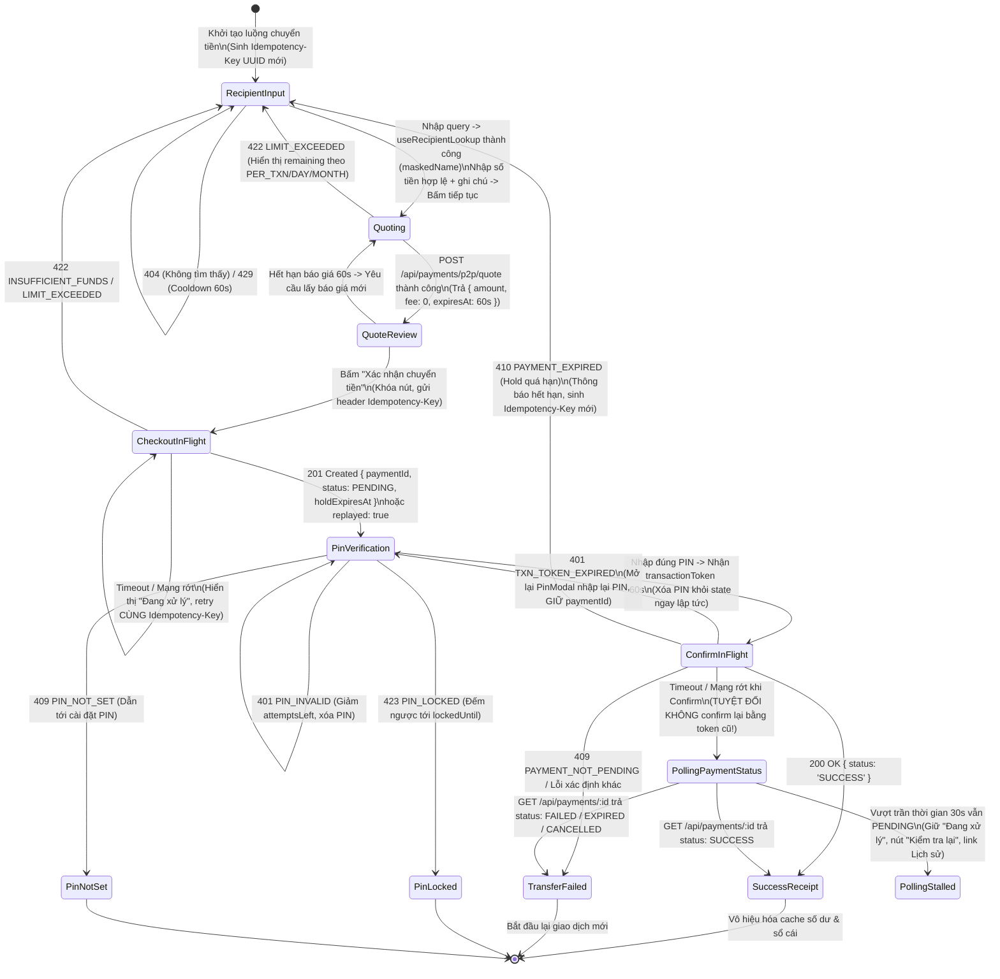

# THIẾT KẾ KIẾN TRÚC TOÀN DIỆN K18, K19, K22: FINVAULT WEB WALLET

## TÓM TẮT KIỂM KÊ HIỆN TRẠNG HỆ THỐNG (30 DÒNG)
1. **Repo FE & Nhánh gốc**: `PTPMHDV_Frontend`, nhánh gốc để tách là `ec9e776` (Merge PR #12). Build `tsc -b && vite build` xanh; test unit 16/16 pass; lint ESLint 9 + TypeScript 5.8.
2. **Thư viện chính**: React 19, React Router v7, `@tanstack/react-query` v5, Axios, Lucide React, Radix UI, Tailwind CSS v4, Vitest v3, MSW v2.
3. **Nhánh cũ `feat/k18-web-wallet`**: Gồm 10 commit cũ (`153ba76` đến `3bd76ea`). Dùng lại ~85% code cũ, tách và tái cấu trúc thành 3 mốc riêng biệt K18, K19, K22 theo bảng ánh xạ.
4. **Kiểm kê `walletService` hiện có**: Tồn tại 5 hàm cũ (`getBalance`, `topup`, `debit`, `transfer`, `getHistory`). Được gọi tại `RealBalanceCard.tsx:24` và `tests/auth-api.test.ts:110`.
5. **TopupModal & RealBalanceCard**: `RealBalanceCard` tại `src/features/wallet/components/RealBalanceCard.tsx:14`, `TopupModal` tại `TopupModal.tsx:14`. Chưa bị import vào các màn hình chính; cần dọn dẹp hoặc chuẩn hóa về `/wallets/me`.
6. **Sử dụng Number cho tiền trong code cũ**: `RealBalanceCard` cũ dùng `Number(balance)`, `format.ts` cũ dùng `Number(amount) / toLocaleString()`. Đã được dọn dẹp ở K18-1 cũ sang `src/lib/money.ts`.
7. **PinModal**: Đã có tại `src/features/auth/components/PinModal.tsx`. Props: `open`, `amount`, `paymentId`, callback `onSuccess(transactionToken)`. Xử lý các mã lỗi `PIN_INVALID`, `PIN_LOCKED`, `PIN_NOT_SET`.
8. **useRecipientLookup**: Đã có tại `src/features/user/hooks/useRecipientLookup.ts`. Gọi `GET /api/users/lookup?q=`, trả về `recipient.authUserId` (UUID) và `maskedName`. Xử lý 404 chung và 429 cooldown.
9. **QueryBoundary**: Đã có tại `src/components/common/QueryBoundary.tsx`, quản lý 4 trạng thái `isLoading`, `isError` (kèm retry), `isEmpty`, và `children`.
10. **Đối chiếu OpenAPI - Header confirm**: Backend `payment-service` yêu cầu header chuẩn là `X-Transaction-Token` (hỗ trợ fallback body `transactionToken`, báo `TXN_TOKEN_MISMATCH` nếu lệch nhau).
11. **Đối chiếu OpenAPI - /wallets/me/ledger (K22)**: Backend KHÔNG có tham số lọc ngày hoặc loại (`BLOCKED-BACKEND`). Tuy nhiên, mỗi dòng ledger CÓ `balanceAfter`, `transferType`, `direction`, `amount`, `createdAt`.
12. **Scripts/Tests A1, A2, A9**: Đã có trong `src/test/acceptance-k18.test.tsx` giả lập kiểm thử giao diện. Seed users: `an@demo.vn` (Cấp 2: 1.250.000đ), `binh@demo.vn` (Cấp 1: 300.000đ), `chi@demo.vn` (Cấp 0: 100.000đ).
13. **Workspace chung Web/Mobile**: Cấu hình npm workspaces sẵn sàng: `apps/mobile` (`@finvault/mobile`) và `packages/api-client` (`@finvault/api-client`) dùng chung độc lập DOM.

---

## 1. BẢNG ÁNH XẠ COMMIT CŨ → MỚI VÀ KẾ HOẠCH DÙNG LẠI CODE

| Mã mới | Ý nghĩa công việc | Hash cũ tham chiếu | Quyết định xử lý |
| :--- | :--- | :--- | :--- |
| **K18-0** | Docs chốt thiết kế cho cả ba việc | `153ba76` [K18-0] | Viết mới `docs/k18-k19-k22-design.md`, tích hợp toàn bộ kế hoạch K18, K19, K22. |
| **K18-1** | Tiền BigInt + api-client chuẩn | `b544b77` [K18-1] | Dùng lại `src/lib/money.ts`, `packages/api-client`, bổ sung test tĩnh chặn `Number`. |
| **K18-2** | features/wallet/api + queries cho /me và /me/ledger | *MỚI* (tách từ K18-2/6 cũ) | Xây dựng layer `features/wallet/api/walletMe.ts` và hook React Query độc lập DOM. |
| **K18-3** | Dọn walletService, gỡ/viết lại TopupModal & RealBalanceCard | *MỚI* (tách từ K18-7 cũ) | Xóa 5 hàm cũ trong `walletService`, gỡ bỏ triệt để các route `/wallets/:userId/*`. |
| **K18-4** | DashboardPage tích hợp số dư và hạn mức | `a806ac2` [K18-2] | Dùng lại `DashboardPage.tsx`, bọc qua `QueryBoundary`, tính hạn mức bằng `BigInt`. |
| **K18-5** | Quét tĩnh chặn route ví cũ & Number cho tiền, kiểm tra CI | `05a13d1` [K18-7] | Dùng lại `src/test/static-money-rules.test.ts`, xác nhận build và test CI xanh. **[DỪNG 1]** |
| **K19-1** | TransferPage bước 1: useRecipientLookup, quote | `447e9f7` [K18-3] | Dùng lại bước 1 `TransferPage.tsx`, tích hợp `useRecipientLookup`, tính quote. |
| **K19-2** | TransferPage bước 2-3: checkout, PinModal, confirm | `50de632` [K18-4] | Dùng lại checkout với `Idempotency-Key`, mở `PinModal` nhận `paymentId` từ checkout, gọi confirm. |
| **K19-3** | Timeout, "đang xử lý", thử lại an toàn cùng khóa | `bc00847` [K18-5] | Dùng lại state machine timeout polling `GET /payments/:id`, backoff có trần, không confirm lại. |
| **K19-4** | E2E nghiệm thu: an→binh, A1, A2, A9, network tab | `dbf4d13` [K18-8] | Dùng lại test acceptance suite, xác nhận network tab không còn route cấm. **[DỪNG 2]** |
| **K22-1** | TransactionsPage: cursor + QueryBoundary | `d56359d` [K18-6] | Dùng lại `TransactionsPage.tsx`, phân trang Keyset Cursor server-driven. |
| **K22-2** | Bộ lọc ngày và loại (server-driven / BLOCKED-BACKEND) | *MỚI* | Dựng UI lọc ngày GMT+7 và loại giao dịch, đặt sau cờ cấu hình `ledgerFilters`. |
| **K22-3** | Đối chiếu lịch sử với số dư của seed | *MỚI* | Tận dụng trường `balanceAfter` có sẵn trong OpenAPI để đối chiếu số dư sổ cái seed. |
| **K22-4** | Tài liệu tổng kết hoàn thiện cả 3 việc | `229c7e7` [K18-9] | Cập nhật tài liệu, hướng dẫn chạy E2E, checklist nghiệm thu bàn giao. |

---

## 2. SƠ ĐỒ TRẠNG THÁI MÀN HÌNH CHUYỂN TIỀN P2P (K19 STATE MACHINE)



---

## 3. VÒNG ĐỜI IDEMPOTENCY-KEY & TRANSACTION-TOKEN

### 3.1. Idempotency-Key
- **Phạm vi áp dụng**: Gửi qua header `Idempotency-Key: <UUID>` tại endpoint `POST /api/payments/p2p/checkout`.
- **Nguyên tắc sinh**: Sinh 1 UUID v4 duy nhất khi người dùng xác nhận thông tin ở Bước 1 để bắt đầu chuyển tiền.
- **Nguyên tắc tái sử dụng (Safe Retry)**:
  - Khi gặp lỗi mạng hoặc Timeout ở bước Checkout: Bắt buộc tái sử dụng đúng `Idempotency-Key` này khi người dùng bấm "Thử lại".
  - Khi người dùng bấm đúp chuột nhanh: Handler dùng cờ `isSubmitting` chặn ngay tại memory; nếu cả 2 request cùng bay lên mạng, backend sẽ chỉ tạo 1 bản ghi và trả `replayed: true` ở request thứ hai.
- **Nguyên tắc hủy & cấp mới**: Chỉ sinh key mới khi:
  - Giao dịch đã hoàn tất (Thành công hoặc Thất bại cuối cùng).
  - Người dùng thay đổi thông tin người nhận, số tiền, hoặc ghi chú.
  - Giao dịch bị server báo `410 PAYMENT_EXPIRED`.

### 3.2. Transaction-Token
- **Phạm vi áp dụng**: Gửi qua header `X-Transaction-Token: <token>` tại endpoint `POST /api/payments/:id/confirm`.
- **Thời hạn sống**: JWT ký số bảo mật dùng 1 lần, có hạn sống 60 giây (`expiresIn: 60`).
- **Nguyên tắc bảo mật**:
  - Không bao giờ lưu vào `localStorage`, `sessionStorage`, cookies hay in ra `console.log`.
  - Chỉ lưu tạm trong bộ nhớ của hook/component.
  - Sau khi submit `confirm` hoặc khi người dùng tắt modal, token được xóa khỏi bộ nhớ.
  - Khi confirm bị timeout/lỗi mạng: **CẤM** gửi lại confirm với token cũ vì token có thể đã bị server tiêu thụ (gây lỗi `409 TXN_TOKEN_REUSED`). Thay vào đó phải chuyển sang Polling `GET /api/payments/:id`.

---

## 4. BẢNG ÁNH XẠ MÃ LỖI BACKEND → THÔNG ĐIỆP TIẾNG VIỆT THÂN THIỆN

| Mã lỗi (Code) | HTTP Status | Thông điệp hiển thị cho người dùng | Hành động xử lý của UI |
| :--- | :---: | :--- | :--- |
| `RECIPIENT_NOT_FOUND` | 404 | "Không tìm thấy người nhận phù hợp. Vui lòng kiểm tra lại email hoặc số điện thoại." | Báo lỗi chung, không lộ thông tin nội bộ. |
| `TOO_MANY_REQUESTS` | 429 | "Bạn đang thao tác quá nhanh. Vui lòng thử lại sau {remaining} giây." | Khóa nút tìm kiếm theo thời gian cooldown. |
| `INSUFFICIENT_FUNDS` | 422 | "Số dư khả dụng trong ví không đủ để thực hiện giao dịch này." | Hiển thị nút nạp tiền hoặc giảm số tiền. |
| `LIMIT_EXCEEDED` (`PER_TXN`) | 422 | "Vượt quá hạn mức tối đa cho mỗi lần chuyển ({limit} đ). Bạn còn được chuyển tối đa {remaining} đ trong lần này." | Gợi ý giảm số tiền hoặc nâng cấp KYC. |
| `LIMIT_EXCEEDED` (`PER_DAY`) | 422 | "Vượt quá hạn mức giao dịch trong ngày ({limit} đ). Hôm nay bạn chỉ còn được chuyển thêm {remaining} đ." | Gợi ý nâng cấp KYC để tăng hạn mức. |
| `LIMIT_EXCEEDED` (`PER_MONTH`) | 422 | "Vượt quá hạn mức giao dịch trong tháng ({limit} đ). Trong tháng này bạn còn lại {remaining} đ." | Gợi ý nâng cấp KYC để tăng hạn mức. |
| `PIN_INVALID` | 401 | "Mã PIN không chính xác. Bạn còn {attemptsLeft} lần thử trước khi bị khóa." | Xóa PIN đã nhập, focus lại ô đầu tiên. |
| `PIN_LOCKED` | 423 | "Tài khoản bị tạm khóa giao dịch do nhập sai PIN quá 5 lần. Vui lòng thử lại sau {countdown}." | Khóa ô nhập PIN, hiển thị đồng hồ đếm ngược. |
| `PIN_NOT_SET` | 409 | "Bạn chưa thiết lập mã PIN giao dịch. Vui lòng thiết lập mã PIN để bảo vệ tài khoản." | Nút chuyển hướng tới màn cài đặt PIN. |
| `TXN_TOKEN_EXPIRED` | 401 | "Mã xác thực giao dịch đã hết hạn. Vui lòng nhập lại mã PIN để tiếp tục." | Mở lại PinModal, giữ nguyên `paymentId`. |
| `TXN_TOKEN_REUSED` | 409 | "Mã xác thực đã được xử lý. Hệ thống đang đồng bộ kết quả..." | Chuyển ngay sang kiểm tra `GET /payments/:id`. |
| `PAYMENT_EXPIRED` | 410 | "Giao dịch đã hết hạn thanh toán (quá 5 phút). Vui lòng thực hiện lại giao dịch mới." | Đóng modal, sinh `Idempotency-Key` mới. |
| `TIMEOUT` / `NETWORK_ERROR` | 504 / 0 | "Kết nối mạng gián đoạn. Giao dịch đang được xử lý, vui lòng không thực hiện lại." | Bật màn hình chờ và cơ chế poll/retry an toàn. |

---

## 5. KIẾN TRÚC TIỀN TỆ DUY NHẤT (MONEY UTILITY SPECIFICATION)

1. **Nguyên tắc kiểu dữ liệu**:
   - Mọi biến tiền trong state, form, DTO, API response/request bắt buộc là **`string`** chứa chữ số nguyên VND (Ví dụ: `"100000"`).
   - Tuyệt đối cấm dùng kiểu `number`, `parseFloat`, `parseInt`, `.toFixed()` trên giá trị tiền tệ.
   - So sánh, cộng trừ tiền bắt buộc dùng **`BigInt`**.
2. **Module tiền chuẩn `src/lib/money.ts`**:
   - `parseVndToBigInt(val: string): bigint`: Parse chuỗi tiền thành `bigint`, hỗ trợ lọc bỏ phần đuôi `.00` từ database PostgreSQL Decimal, ném lỗi nếu chứa số âm/thập phân/chữ cái.
   - `formatVnd(val: string | bigint): string`: Trình bày tiền chuẩn theo định dạng Việt Nam có dấu chấm phân cách hàng nghìn (ví dụ: `1.250.000 đ`).
   - `compareMoney(a: string, b: string): number`: So sánh 2 chuỗi tiền (-1, 0, 1) thông qua BigInt.
   - `isValidMoneyInput(val: string): boolean`: Kiểm tra input chỉ gồm các chữ số nguyên dương `^[1-9]\d*$`.
3. **Bộ quét tĩnh CI Guard (`src/test/static-money-rules.test.ts`)**:
   - Tự động duyệt qua toàn bộ mã nguồn `src/` và `packages/` trong mỗi lượt chạy CI để chặn đứng việc tái vi phạm `Number()`, `parseFloat()`, `parseInt()`, `.toFixed()` trên các trường tiền.

---

## 6. CẤU TRÚC FEATURES/WALLET VÀ GÓI DÙNG CHUNG CHO MOBILE

```text
packages/api-client/
├── src/
│   ├── client.ts             # API Client thuần túy độc lập DOM, hỗ trợ timeout, Idempotency-Key
│   ├── types.ts              # Interface chuẩn: WalletBalance, LedgerEntry, P2pQuote, Checkout, Confirm
│   └── errors.ts             # Parser mã lỗi có cấu trúc
apps/mobile/                  # Sử dụng chung @finvault/api-client
src/features/wallet/
├── api/
│   └── walletMe.ts           # getMyWallet(), getMyLedger()
├── hooks/
│   ├── useMyWallet.ts        # TanStack Query hook lấy số dư và hạn mức
│   ├── useMyLedger.ts        # Infinite Query hook lấy lịch sử sổ cái qua Keyset Cursor
│   └── useP2pTransfer.ts     # Hook cỗ máy trạng thái chuyển tiền P2P
└── components/
    └── WalletBalanceCard.tsx # Component hiển thị số dư dùng /wallets/me
```

---

## 7. KẾ HOẠCH CHO K22-2 (BỘ LỌC) & K22-3 (ĐỐI CHIẾU SỔ CÁI SEED)

1. **K22-2 (Bộ lọc ngày và loại)**:
   - *Hiện trạng backend*: OpenAPI `services/wallet-service/docs/openapi.json` tại `/wallets/me/ledger` chỉ có 2 tham số query: `cursor` và `limit`. Chưa hỗ trợ tham số `startDate`, `endDate`, `type`.
   - *Quy tắc tuân thủ*: Không tự ý lọc client-side trên từng trang (sẽ gây thiếu dữ liệu ở các trang sau).
   - *Triển khai*: Dựng đầy đủ UI bộ lọc (chọn khoảng ngày GMT+7 và dropdown loại giao dịch), đặt sau cờ tính năng `ENABLE_LEDGER_SERVER_FILTERS` (mặc định `false`). Trong test suite, kiểm thử truyền tham số giả định qua mock server và ghi nhận vào báo cáo `BLOCKED-BACKEND`.
2. **K22-3 (Đối chiếu lịch sử với số dư seed)**:
   - *Hiện trạng*: Mỗi bản ghi trả về từ `/wallets/me/ledger` đã có sẵn trường `balanceAfter: string`.
   - *Triển khai*: Viết hàm kiểm tra tính toàn vẹn `verifyLedgerIntegrity(items, currentBalance)`:
     - Duyệt danh sách ledger của các tài khoản seed (`an@demo.vn`, `binh@demo.vn`, `chi@demo.vn`).
     - Xác nhận `items[0].balanceAfter === currentBalance`.
     - Với mọi cặp phần tử liên tiếp `i` và `i+1`: $balanceAfter_{i} = balanceAfter_{i+1} \pm amount_{i}$.
